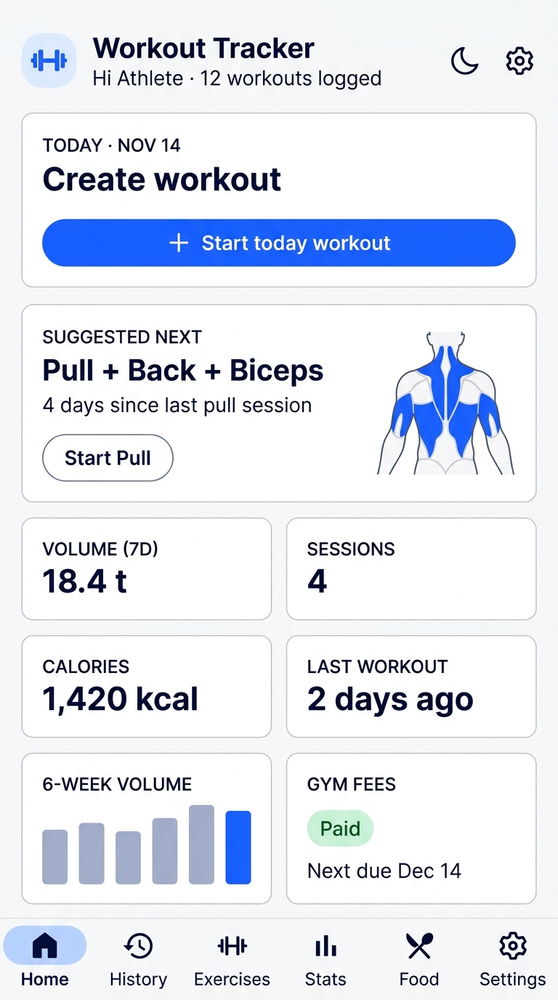
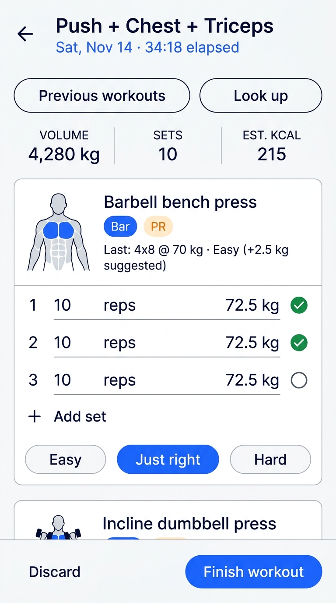
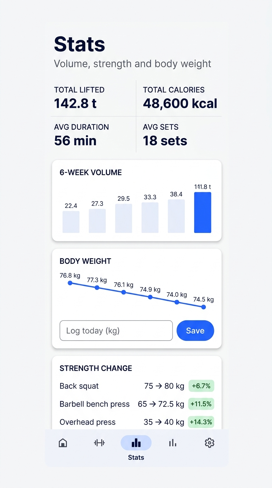

# Workout Tracker

An offline-first Android gym workout tracker built with **Kotlin** and **Jetpack Compose (Material 3)**. Designed to replace unstructured gym notes with fast set logging, progressive overload cues, anatomical muscle references, local JSON backup/restore, strength analytics, and optional Gemini AI exercise identification.

---

## Screenshots

| Home Dashboard | Live Workout Session | Stats & Analytics |
| :---: | :---: | :---: |
|  |  |  |

---

## Core Functionalities

### 1. Onboarding & Athlete Profile
- **3-Step First-Launch Setup**: Collects name, age, gender, height, body weight, optional body fat %, training experience level, preferred split, and next gym fee due date.
- **Empty Start or Sample Data**: Starts with a clean empty log by default, with a one-tap option to load 10 sample workouts (available during onboarding, on an empty Home screen, or in **Settings**).

### 2. Home Dashboard
- **Create Workout & Resume Banner**: Start a workout directly with today's date, or resume an in-progress draft session with a live elapsed timer.
- **Suggested Next Split**: Automatically recommends whichever split (`Push`, `Pull`, `Shoulders + abs`, `Legs`) has gone the longest without training, paired with an anatomical muscle-highlight preview.
- **Weekly KPIs & Volume Trend**: Displays 7-day volume lifted, session count, estimated calories burnt, days since last session, a 6-week rolling volume bar chart, and current gym fee status.

### 3. Two-Step Workout Logging
- **Step 1 — Session Setup**: Pick a workout date, choose a split preset (showing when each split was last trained), or multi-select any combination of muscle groups (`Push`, `Pull`, `Chest`, `Back`, `Shoulders`, `Biceps`, `Triceps`, `Legs`, `Abs`, `Cardio`).
- **Step 2 — Live Session**:
  - Live elapsed timer, session **Volume**, **Sets**, and **Est. kcal** summary strip.
  - Quick shortcuts to **Previous workouts** (filtered by your selected muscle groups so you can inspect past weights/sets and avoid repeating stale sessions) and **Look up** (exercise picker).
  - **Exercise Cards**: Displays a custom `Canvas` anatomical muscle-highlight graphic, equipment badge (`Bar`, `Dumbbell`, `Machine`, `Cable`, `Bodyweight`), live **PR** indicator, and a **Last time** summary.
  - **Set Logging & Progressive Overload**: Editable reps and weight (`kg`) rows with completion checkmarks, `+ Add set` / `Remove set`, optional session & per-exercise notes, and a difficulty rating (`Easy`, `Just right`, `Hard`). Marking an exercise **Easy** automatically suggests `+2.5 kg` on your next session for that lift.

### 4. Exercise Library, Custom Exercises & "Describe It" Identifier
- **Built-In + Custom Catalog**: Includes 55 built-in gym exercises plus support for creating custom exercises with muscle group and equipment tags.
- **Suggested & Searchable Picker**: Ranks exercises by your own historical frequency for the active muscle groups and lets you filter by muscle group or equipment.
- **Describe-to-Identify**: Type a plain-English description of a machine or movement (e.g., *"pull a wide bar down while seated"*) for instant **on-device keyword matching**, with an optional **Ask Gemini AI** button powered by Firebase AI Logic (`gemini-3.8-flash` structured JSON output) when online.
- **Exercise Detail Screen**: Shows anatomical muscle highlights, personal best weight, estimated 1RM, session count, a top-set progression line chart, and full lift history.

### 5. History & Progress Analytics
- **History Tab**: Browse all logged sessions filtered by muscle group, expand cards to review sets, weights, difficulty ratings, PR counts, notes, and delete individual sessions.
- **Stats Tab**:
  - All-time total volume lifted, total estimated calories, average duration, and average sets per session.
  - **6-Week Rolling Volume** bar chart.
  - **Body Weight Trend** line chart with inline daily weigh-in logging.
  - **Strength Change** tracker comparing first vs. latest estimated 1RM (`%` change) on key compound lifts.
  - **4-Week Set Distribution** per muscle group.

### 6. Gym Fees, Body Tracking & Local JSON Backup
- **Gym Fee Tracker**: View and edit your **Last paid**, **Next due**, and fee **Amount**, with automatic `Paid`, `Due in Xd`, and `Overdue` status badges plus a one-tap **Mark paid today** action.
- **Body Measurements & Progress Photos**: Track Waist, Chest, Arm (`cm`), and calculated BMI, and attach local **Front / Side / Back** progress photos using the zero-permission Android Photo Picker (stored privately inside app files).
- **Local Export & Import**:
  - Export your complete history, custom exercises, profile, measurements, weigh-ins, and gym fees to a single `.json` file via Android's Storage Access Framework (**Settings → Export**).
  - Restore a full backup—or import a workouts-only JSON file (`sessions` + `customExercises`) while keeping your existing profile, body weights, and gym fees intact—via **Settings → Import**.

### 7. Additional Features
- **Food & Calories Tab**: Dedicated preview tab displaying estimated daily calorie and protein targets with upcoming meal-logging slots (*Coming soon*).
- **Appearance**: Light, Dark, and System theme modes with a quick toggle in the top app bar.
- **Adaptive Layout**: Automatically switches between a compact bottom `NavigationBar` on phones and a side `NavigationRail` on tablets/foldables (`>= 600dp`).

---

## Tech Stack

- **Language & UI**: Kotlin, Jetpack Compose, Material Design 3, custom `Canvas` charts & anatomical muscle figures, bundled `Inter` typography
- **Architecture**: MVVM with `ViewModel`, Kotlin Coroutines, and `StateFlow`
- **Navigation**: Navigation Compose with adaptive `NavigationBar` / `NavigationRail`
- **Local Storage**: Room (workouts, exercises, sets, body weight log, custom exercises) + Jetpack DataStore Preferences (profile, measurements, gym fees, theme, local photo paths) + Moshi JSON serialization
- **Media & Storage APIs**: Android Photo Picker (`PickVisualMedia`) and Storage Access Framework (`CreateDocument` / `OpenDocument`) — no broad storage permissions required
- **AI Integration (Optional)**: Firebase AI Logic (`gemini-3.8-flash`) protected with Firebase App Check (Debug provider for debug builds, reCAPTCHA Enterprise for release builds)

---

## Project Setup & Running Tests

1. Clone the repository and open it in **Android Studio** (or build via Gradle with JDK 17+).
2. Add your own Firebase configuration (`app/google-services.json`) if you want to enable the optional **Ask Gemini AI** exercise lookup feature. All offline logging, charts, local storage, and JSON export/import features work without any network or Firebase setup.
3. Build and run unit/Robolectric tests:

```bash
./gradlew assembleDebug
./gradlew :app:testDebugUnitTest
```
